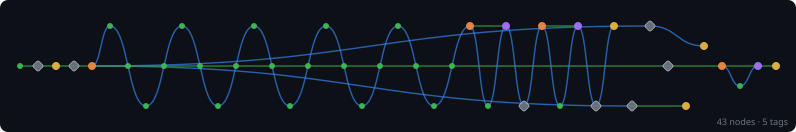

# design-flows

<!-- Project Shields/Badges -->
<p align="center">
  <a href="https://github.com/XAOSTECH/design-flows">
    
  </a>
  <a href="https://github.com/XAOSTECH/design-flows/releases">
    
  </a>
  <a href="https://github.com/XAOSTECH/design-flows/blob/main/LICENSE">
    
  </a>
</p>

<p align="center">
  <a href="https://github.com/XAOSTECH/design-flows/actions">
    
  </a>
  <a href="https://github.com/XAOSTECH/design-flows/issues">
    
  </a>
  <a href="https://github.com/XAOSTECH/design-flows/pulls">
    
  </a>
  <a href="https://github.com/XAOSTECH/design-flows/stargazers">
    
  </a>
  <a href="https://github.com/XAOSTECH/design-flows/network/members">
    
  </a>
</p>

<p align="center">
  
  
  
  
</p>

<!-- Optional: Stability/Maturity Badge -->
<p align="center">
  
  
</p>

---

<p align="center">
  <b>Unix Design Flows</b>
</p>

---

> **Note:** This repository is part of the [**design-tools**](https://github.com/XAOSTECH/design-tools) monorepo.  
> 📚 [**View full documentation →**](https://xaostech.github.io/design-tools)

---

## 📋 Table of Contents

- [Overview](#-overview)
- [Available Flows](#-available-flows)
- [Installation](#-installation)
- [Usage](#-usage)
- [Flow Development](#-flow-development)
- [Documentation](#-documentation)
- [Contributing](#-contributing)
- [Licence](#-licence)

---

## 🔍 Overview

**design-flows** provides automated design workflow scripts for Unix-like systems. Each flow is a self-contained tool that automates specific design tasks.

### Available Flows

#### vsGen — VS Code Theme Generator

**Location:** `flows/vsGen/`

Generates VS Code workspace colour themes from 3 base colours with intelligent palette expansion.

**Features:**
- 10 shades per colour (light to dark gradients)
- Analogous, triadic, and split-complementary harmonies
- WCAG contrast ratio protection (≥3.0)
- 8 built-in presets
- Configurable variation level
- Auto-installs dependencies

#### palGen — Palette & Design-Token Exporter

**Location:** `flows/palGen/`

Flattens a generated palette into named tokens and exports them into portable formats for other design tools and codebases.

**Features:**
- Named token model (`primary-50` … `primary-900`, harmonic accents, derived `base-*` surfaces)
- Seven export formats: CSS, SCSS, Tailwind, W3C design-token JSON, GIMP `.gpl`, SVG swatch sheet, Android `colors.xml`
- Shares the same presets, harmonies, variation and `--invert` options as the other flows
- WCAG-aware foreground and surface tokens

#### uiGen — Desktop UI Theme Generator

**Location:** `flows/uiGen/`

Generates desktop GUI themes (GNOME Shell, GTK, KDE, GDM, GRUB, icons, rofi, Chrome, Firefox) from a shared colour palette.

**Features:**
- GNOME Shell and GTK 3/4 themes (with optional CSS animations)
- KDE, GDM, GRUB, icon, rofi and browser targets
- Shares presets, harmonies, variation and `--invert` with the other flows
- Delegates terminal/shell surfaces to tuiGen, so `--target all` themes GUI and terminal in a single run

#### tuiGen — Terminal & Shell Theme Generator

**Location:** `flows/tuiGen/`

Generates terminal and shell colour themes from the shared palette. See [tuiGen README](../flows/tuiGen/README.md).

**Features:**
- First-class targets: kitty, starship, tmux
- Scaffold targets for other setups: alacritty, foot, fish
- Shared 16-colour ANSI derivation across the terminal emulators
- Receives delegated terminal/shell work from uiGen; runtime palette cycling lives in the `themes` repository

### Why design-flows?

Design workflows involve repetitive tasks that can be automated. design-flows provides:

- **Consistency** — Automated workflows ensure consistent output
- **Speed** — Generate complex themes in seconds
- **Accessibility** — Built-in WCAG compliance checks
- **Flexibility** — Highly configurable with sensible defaults

---

## 📥 Installation

### Prerequisites

- Bash 5.0+
- Git
- [pastel](https://github.com/sharkdp/pastel)

### Standalone Installation

```bash
# Clone the repository
git clone https://github.com/XAOSTECH/design-flows.git
cd design-flows
```

### Monorepo Installation

```bash
# Clone the entire monorepo
git clone --recursive https://github.com/XAOSTECH/design-tools.git
cd design-tools/design-flows
```

In the `design-tools` monorepo, `pastel` is delivered as a root submodule at
`../pastel/`.

`vsGen` resolves `pastel` in this order:
1. `PASTEL_BIN` (explicit override)
2. Monorepo submodule binary: `../pastel/target/release/pastel` (or debug)
3. System `pastel` from `PATH`
4. Auto-install fallback

If you use monorepo `pastel`, build it once:

```bash
./flows/vsGen/lib/deps.sh --build --check -v
```

This keeps `vsGen` itself unchanged and lets you trigger submodule build logic manually from `deps.sh` when you want it.

---

## 🚀 Usage

### vsGen Examples

```bash
cd flows/vsGen

# Use a built-in preset
./src/vsGen --preset sakura

# Custom colour combinations
./src/vsGen -p coral -s gold -t skyblue

# High variation with complementary colours
./src/vsGen -p "#ff1493" -s "#ffd700" --variation 0.8 --compl

# Preview without writing files
./src/vsGen --preset neon --dry-run -v

# Update existing workspace
./src/vsGen -c project.code-workspace -p violet -s lime

# List all presets
./src/vsGen --list-presets
```

### Output

vsGen generates VS Code workspace files at:

```
./out/<ThemeName>-<YYYY-MM-DD>-v<VERSION>.code-workspace
```

Open in VS Code:

```bash
code ./out/My-Theme-2026-03-05-v1.1.0.code-workspace
```

### palGen Examples

```bash
cd flows/palGen

# Export a web design-token bundle
./src/palGen --format css,scss,tailwind -p pink -s purple --name Blossom

# Every format at once
./src/palGen --format all --preset dracula

# Printable SVG swatch sheet
./src/palGen --format svg -p coral -s gold -t skyblue

# Preview a Tailwind config without writing
./src/palGen --format tailwind -p "#ff69b4" --dry-run -v

# List available formats
./src/palGen --list-formats
```

### palGen Output

palGen writes one file per format into:

```
./out/<PaletteName>-<YYYY-MM-DD>/
```

### tuiGen Examples

```bash
cd flows/tuiGen

# Terminal + prompt + multiplexer
./src/tuiGen --target kitty,starship,tmux -p pink -s purple --name NeonPink

# Every terminal/shell target from a preset
./src/tuiGen --target all --preset dracula

# Preview a kitty theme without writing
./src/tuiGen --target kitty -p "#ff69b4" --dry-run -v

# List available targets
./src/tuiGen --list-targets
```

### tuiGen Output

tuiGen writes one directory per target into:

```
./out/<ThemeName>-<YYYY-MM-DD>/<ThemeName>/<target>/
```

uiGen can also drive tuiGen for you — it themes the GUI itself and delegates the terminal/shell set:

```bash
cd flows/uiGen
./src/uiGen --target all --preset neonpink
```

---

## 🛠️ Flow Development

### Structure

Each flow should follow this structure:

```
flows/
└── <flow-name>/
    ├── README.md           # Flow-specific documentation
    ├── src/
    │   └── <flow-name>     # Main executable
    ├── lib/                # Optional libraries
    │   ├── deps.sh         # Dependency checks
    │   └── ...
    └── test/               # Optional tests
        └── test.sh
```

### Guidelines

1. **Modular** — Extract reusable functions into `lib/`
2. **Self-documenting** — Include `--help` and examples
3. **Error handling** — Use `set -euo pipefail`
4. **Logging** — Provide verbose output with `-v`
5. **Dependencies** — Auto-install when possible
6. **UK English** — Use British spelling (colour, not colour)

### Example 1: Generate a New Theme

```bash
cd flows/vsGen
./src/vsGen --preset sakura -n "Sakura Workspace"
```

### Example 2: Update Existing Workspace Colours

```bash
cd flows/vsGen
./src/vsGen -c ../../project.code-workspace -p coral -s gold -t skyblue --variation 0.8
```

---

## ⚙️ Configuration

### Environment Variables

| Variable | Description | Default |
|----------|-------------|---------|
| `FLOWS_VERBOSE` | Enable verbose logging (`1` to enable) | `0` |
| `PASTEL_BIN` | Override pastel executable path | `pastel` |

### Configuration File

```yaml
# config.yml
default_flow: vsGen
default_preset: sakura
variation: 0.5
background_lightness: 0.12
complementary_colours: true
```

---

## 📚 Documentation

### Flow Documentation

| Flow | Documentation | Description |
|------|---------------|-------------|
| **vsGen** | [README](../flows/vsGen/README.md) | VS Code workspace theme generator |
| **palGen** | [Overview](#-available-flows) | Palette & design-token exporter |
| **uiGen** | [Overview](#-available-flows) | Desktop GUI theme generator (delegates TUI to tuiGen) |
| **tuiGen** | [README](../flows/tuiGen/README.md) | Terminal & shell theme generator |

### Additional Resources

- [design-tools monorepo](https://github.com/XAOSTECH/design-tools)
- [Contributing Guidelines](../CONTRIBUTING.md)
- [GitHub Pages](https://xaostech.github.io/design-tools)

---

## 🤝 Contributing

Contributions are welcome! See [CONTRIBUTING.md](../CONTRIBUTING.md) for guidelines.

### Workflow

1. **Fork** and clone the repository
2. **Create branch**: `git checkout -b flow/<flow-name>`
3. **Develop** following flow development guidelines
4. **Test** thoroughly with various inputs
5. **Commit** with conventional commits: `feat(flow): add feature`
6. **Push** and open a Pull Request
2. Create your feature branch (`git checkout -b feature/AmazingFeature`)
3. Commit your changes (`git commit -m 'Add some AmazingFeature'`)
4. Push to the branch (`git push origin feature/AmazingFeature`)
5. Open a Pull Request

See also: [Code of Conduct](CODE_OF_CONDUCT.md) | [Security Policy](SECURITY.md)

---

## 🗺️ Roadmap

- [x] vsGen modularised into `src/` + `lib/`
- [x] WCAG readability safeguards for generated themes
- [ ] Add additional flows (terminal theme generator)
- [ ] Add flow-level smoke tests in CI
- [ ] Add optional YAML configuration loading

See the [open issues](https://github.com/XAOSTECH/design-flows/issues) for a full list of proposed features and known issues.

---

## 💬 Support

- 📧 **Email**: maintainers@xaostech.dev
- 💻 **Issues**: [GitHub Issues](https://github.com/XAOSTECH/design-flows/issues)
- 💬 **Discussions**: [GitHub Discussions](https://github.com/XAOSTECH/design-flows/discussions)
- 📝 **Wiki**: [GitHub Wiki](https://github.com/XAOSTECH/design-flows/wiki)

---

## 📄 Licence

Distributed under the GPL-3.0 License. See [`LICENSE`](LICENSE) for more information.

---

## 🙏 Acknowledgements

- [pastel](https://github.com/sharkdp/pastel) for CLI colour tooling
- VS Code workspace settings and colour customisation model
- Contributors and testers in XAOSTECH design workflows

---

<p align="center">
  <a href="https://github.com/XAOSTECH">
    
  </a>
</p>

<p align="center">
  <a href="#design-flows">⬆️ Back to Top</a>
</p>

<!-- TREE-VIZ-START -->



[Full SVG](../.github/static/tree-viz/git-tree.svg) · [Interactive version](../.github/static/tree-viz/git-tree.html) · [View data](../.github/static/tree-viz/git-tree-data.json)

<!-- TREE-VIZ-END -->
